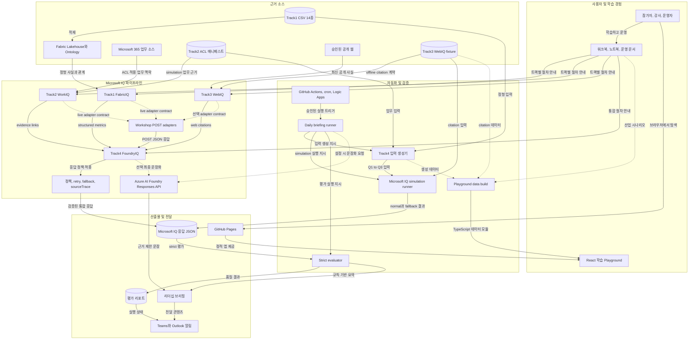
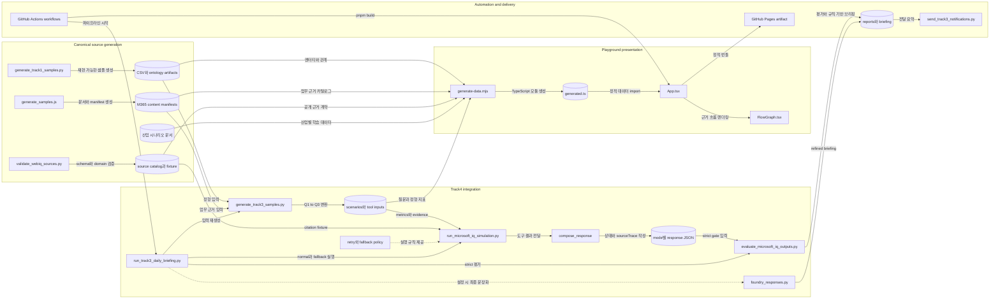

# Architecture Diagram

이 문서는 Microsoft IQ Workshop 저장소의 네 트랙, 근거 소스, 실행 모드, 자동화, 학습 UI를 하나의 구조로 설명합니다. 첫 번째 다이어그램은 전체 시스템 경계를, 두 번째 다이어그램은 실제 저장소 컴포넌트의 실행 흐름을 보여줍니다.

## Application Architecture

<!-- mermaid-checked: no \n, no em-dash/en-dash, no {} in labels, subgraphs are id["label"], arrows are -->|"label"|, all subgraphs closed by end, ids unique -->

### Technology Stack Summary

| Layer | Technology | Version | Purpose |
| --- | --- | --- | --- |
| Structured intelligence | Microsoft Fabric Lakehouse, Fabric Ontology | Service managed | Track1 CSV를 적재하고 엔터티 관계와 정형 KPI를 계산합니다. |
| Work context | Microsoft 365, Microsoft Graph | Service managed | SharePoint, Outlook, Teams, OneDrive의 ACL 적용 업무 근거를 제공합니다. |
| Public evidence | Foundry Agent Service Web Search 또는 WebIQ adapter | Service managed | 공개 웹의 최신 사실을 URL citation과 관찰 시각으로 제공합니다. |
| Orchestration | Python | 3.11 in GitHub Actions | simulation, retry, fallback, strict 평가, 브리핑 생성을 수행합니다. |
| Final wording | Azure AI Foundry Responses API | Repository contract v1 | 근거가 제한된 초안을 최종 리더십 문장으로 다듬습니다. |
| Sample generation | Node.js, docx | Node.js 20, docx 9.5.1 | Track2의 M365 샘플 문서, 메일, 대화, 매니페스트를 재현합니다. |
| Learning UI | React, TypeScript, Vite | React 19.2.8, TypeScript 6.0.2, Vite 8.2.0 | 네 IQ의 역할, sourceTrace, fallback을 브라우저에서 탐색합니다. |
| UI styling and components | Tailwind CSS, Radix UI | Tailwind CSS 3.4.1 | 반응형 학습 UI와 접근 가능한 인터랙션을 구성합니다. |
| Package management | pnpm | 10.32.1 | Playground 의존성과 재현 가능한 빌드를 관리합니다. |
| Automation | GitHub Actions, cron, Azure Logic Apps templates | Repository managed | 수동 또는 승인된 일정 실행, 리포트 보관, Pages 배포를 지원합니다. |
| Delivery | GitHub Pages, Teams webhook, SMTP | Service managed | 정적 Playground와 승인된 브리핑 알림을 전달합니다. |

### Data Storage & External Services

영속 데이터베이스 대신 버전 관리되는 CSV, JSON, Markdown, DOCX, EML과 생성 매니페스트를 사용합니다. Track1의 CSV와 Fabric Ontology가 정형 사실을, Track2의 Microsoft 365 원본과 ACL 매니페스트가 내부 업무 맥락을, Track3의 공개 웹 또는 교육용 fixture가 외부 citation을 담당합니다. Track4는 이 입력을 JSON 응답과 평가 리포트로 저장하며, live 모드에서는 원시 제품 URL이 아닌 승인된 workshop POST adapter와 Azure AI Foundry Responses API를 사용합니다.

### Key Architectural Decisions

- 정형 수치, 내부 업무 맥락, 공개 웹 citation, 최종 결합 책임을 FabricIQ, WorkIQ, WebIQ, FoundryIQ로 분리하고 `sourceTrace`에서 출처를 보존합니다.
- `simulation`은 Track1 CSV, Track2 매니페스트, Track3 fixture를 사용하는 교육 및 회귀 경로이며, `live` 성공으로 표현하지 않습니다.
- retry는 5초, 10초, 20초로 최대 3회 재시도하며, 일부 소스 실패는 명시적 부분응답, 두 내부 근거 실패는 `blocked`로 처리합니다.

## Component Relationships

<!-- mermaid-checked: no \n, no em-dash/en-dash, no {} in labels, subgraphs are id["label"], arrows are -->|"label"|, all subgraphs closed by end, ids unique -->

### Component Inventory

| Component | Layer | Type | Responsibility |
| --- | --- | --- | --- |
| `track1/data/generate_track1_samples.py` | Canonical source | Python generator | 고정 seed로 14개 CSV와 Q1에서 Q5까지의 정형 신호를 재현합니다. |
| `track1/ontology_bundle/` | Canonical source | Fabric definition bundle | 엔터티, 관계, 데이터 바인딩을 Fabric Ontology 계약으로 제공합니다. |
| `track2/data/generate_samples.js` | Canonical source | Node.js generator | SharePoint, Outlook, Teams, OneDrive 샘플과 배포 매니페스트를 생성합니다. |
| `track2/data/deploy_m365_samples.py` | Canonical source | Python deployment adapter | 기본 dry-run으로 M365 작업을 계획하고 승인된 `--execute`에서만 격리 테넌트에 씁니다. |
| `track3/data/validate_webiq_sources.py` | Canonical source | Python validator | WebIQ fixture의 schema, 허용 도메인, Q1에서 Q3 coverage를 검증합니다. |
| `track3/data/source_catalog.json` | Canonical source | JSON policy store | 시나리오별 검색 의도, 허용 도메인, 최소 citation 정책을 정의합니다. |
| `track3/data/web_evidence_fixture.json` | Canonical source | JSON fixture store | 현재 웹 사실이 아닌 offline citation 계약을 제공합니다. |
| `track4/data/generate_track3_samples.py` | Integration | Python input builder | Track1 CSV와 Track2 매니페스트를 Q1에서 Q3 시나리오와 도구 입력으로 변환합니다. |
| `track4/data/run_microsoft_iq_simulation.py` | Integration | Python orchestrator | FabricIQ, WorkIQ, WebIQ 결과를 실행하고 normal 및 장애 모드 응답을 생성합니다. |
| `compose_response` | Integration | Response composer | 근거를 결합하고 `pass`, `partial`, `blocked`, 경고, guardrail, `sourceTrace`를 작성합니다. |
| `execute_tool` | Integration | Retry and fault policy | 고정 retry 정책과 permanent 또는 transient failure simulation을 적용합니다. |
| `track4/data/evaluate_microsoft_iq_outputs.py` | Quality | Python evaluator | citation, sourceTrace, fallback, 개인정보 및 사람 승인 guardrail을 strict 평가합니다. |
| `track4/data/foundry_responses.py` | Integration | Responses API client | 환경 변수 기반 인증으로 선택적 최종 문장화를 수행하고 오류를 명시적으로 전달합니다. |
| `tools/run_track3_daily_briefing.py` | Automation | Python pipeline runner | 입력 생성, 실행, strict 평가, 브리핑, 선택적 LLM refinement를 순서대로 실행합니다. |
| `tools/send_track3_notifications.py` | Delivery | Python notifier | 평가 상태와 브리핑 위치를 Teams webhook 또는 SMTP로 전달합니다. |
| `industry_playground/playground/scripts/generate-data.mjs` | Presentation | Node.js build step | canonical 산출물과 산업 시나리오를 검증하고 `generated.ts`로 변환합니다. |
| `industry_playground/playground/src/App.tsx` | Presentation | React application | 미션, 근거, citation, fallback, sourceTrace 학습 경험을 구성합니다. |
| `industry_playground/playground/src/components/FlowGraph.tsx` | Presentation | React SVG component | 데이터 소스에서 네 IQ와 브리핑으로 이어지는 인터랙티브 경로를 렌더링합니다. |
| `.github/workflows/playground-pages.yml` | Infrastructure | GitHub Actions workflow | Node.js 20에서 Playground를 빌드하고 GitHub Pages artifact를 배포합니다. |
| `.github/workflows/track3-daily-briefing-with-notify.yml` | Infrastructure | GitHub Actions workflow | 수동 승인 경로에서 Python 3.11 브리핑 파이프라인과 알림을 실행합니다. |
